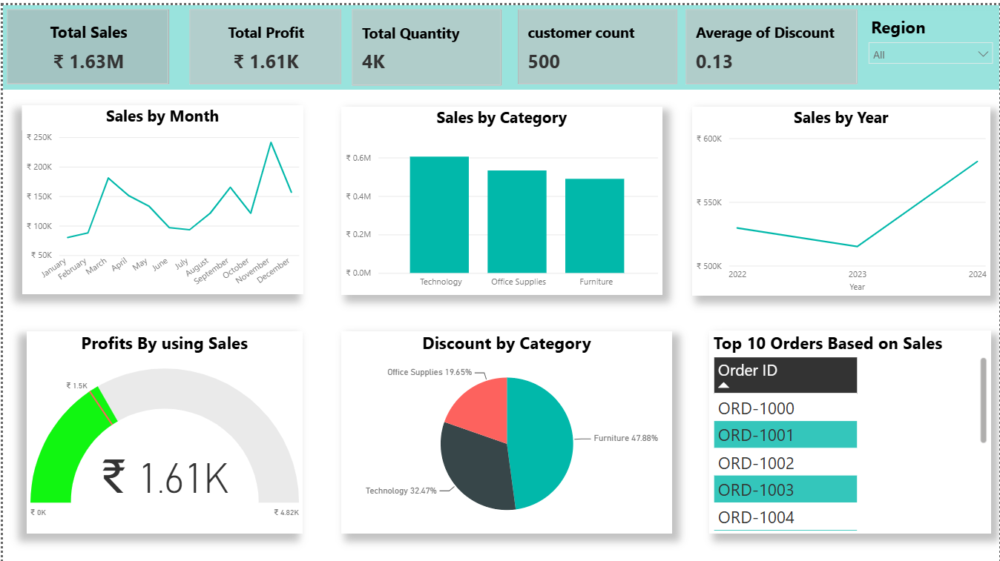

# PalmBridge Retail Optimization Sales Profitability Analysis

An end-to-end data analytics project using **Python, SQL, and Power BI** to clean retail transaction data, perform sales and profitability analysis, and develop an interactive business intelligence dashboard.

## Power BI Dashboard Preview



The interactive dashboard presents key sales and profitability KPIs, monthly and yearly sales trends, category-wise discount distribution, and regional filtering to support retail business analysis.

## Project Overview

The PalmBridge Retail Co. project focuses on analyzing e-commerce retail data to understand sales performance, product category contributions, customer segments, discount patterns, and profitability.

The project follows a data analytics workflow, starting with data cleaning and preprocessing in Python, followed by SQL-based data analysis and interactive dashboard development in Power BI. It demonstrates how raw retail data can be transformed into structured information to support business reporting and decision-making.

## Business Objectives

- Clean and prepare raw retail transaction data for analysis.
- Identify and handle duplicate records and missing values.
- Standardize column names, customer segment labels, and date formats.
- Analyze total sales, total profit, product quantities, and discount patterns.
- Compare sales and profit across product categories and customer segments.
- Examine monthly and yearly sales trends.
- Develop an interactive Power BI dashboard for business performance monitoring.
- Present key performance indicators (KPIs) in an easy-to-understand visual format.

## Tools and Technologies

- **Python:** Data cleaning and preprocessing.
- **Pandas:** Data manipulation, missing-value handling, duplicate removal, and data transformation.
- **NumPy:** Numerical operations.
- **Matplotlib & Seaborn:** Exploratory data visualization.
- **SQL:** Data aggregation, filtering, grouping, and business analysis queries.
- **Microsoft Power BI:** Interactive dashboards, KPIs, charts, and regional filtering.
- **Google Colab:** Cloud-based Python development environment.

## Project Workflow

### 1. Data Cleaning and Preprocessing — Python

The raw retail dataset was processed using Python and Pandas.

Key activities:
- Loaded the raw CSV dataset into a Pandas DataFrame.
- Inspected dataset structure, column names, data types, and sample records.
- Standardized column names for easier analysis.
- Identified and removed duplicate records.
- Checked missing values and applied selected imputation techniques.
- Converted order and shipping date columns into datetime format.
- Standardized customer segment labels.
- Used boxplots to inspect numerical distributions and potential outliers.
- Exported the processed dataset as a CSV file.

### 2. Data Analysis — SQL

SQL queries were developed to analyze the retail data and extract business-relevant summaries.

Analysis areas:
- Total sales and total profit.
- Sales and profit by product category.
- Average discount by category.
- Yearly sales trends.
- Quantity sold and sales by customer segment.
- Transactions associated with the highest discount.

These queries provide a foundation for comparing business performance across different categories, time periods, and customer segments.

### 3. Dashboard Development — Power BI

An interactive Power BI dashboard was developed to present important sales and profitability indicators.

**Key Performance Indicators (KPIs):**
- Total Sales
- Total Profit
- Total Quantity
- Customer Count
- Average Discount

**Visualizations:**
- Sales by Month — Line Chart
- Sales by Category — Line Chart
- Sales by Year — Line Chart
- Total Profit Performance — Gauge Chart
- Discount by Category — Donut Chart
- Transaction-level data table
- Region slicer for interactive filtering

The dashboard enables users to explore sales trends, compare category performance, review discount distribution, and filter results by region.

## Key Dashboard Observations

The submitted project report records the following observations from the Power BI dashboard:

- **Total Sales:** Approximately ₹1.63 million.
- **Total Profit:** Approximately ₹1.61K.
- **Total Quantity:** Approximately 4K units.
- **Customer Count:** 500.
- **Average Discount:** Approximately 0.13, or 13% if the values are stored as decimal proportions.
- **Monthly Sales:** November shows the highest visible sales point, followed by a decline in December.
- **Yearly Sales:** Sales increase substantially in 2024 compared with 2023.
- **Discount Distribution:** Furniture accounts for 47.88%, Technology 32.47%, and Office Supplies 19.65% of the displayed discount distribution.

These observations describe the figures and patterns documented in the dashboard report. The discount distribution represents discounts, not each category's share of sales or profit.

## Skills Demonstrated

- Data cleaning and preprocessing
- Exploratory data analysis (EDA)
- Missing-value and duplicate handling
- Data type conversion and text standardization
- SQL querying and aggregation
- Business KPI analysis
- Data visualization
- Power BI dashboard development
- Retail sales and profitability analysis
- Translating business data into visual reports

## Repository Structure

A suggested repository structure is:

```text
PalmBridge-Retail-Sales-Profitability-Analysis/
│
├── data/
│   ├── palmbridge_raw_data.csv
│   └── palmbridge_cleaned_data.csv
│
├── notebooks/
│   └── PalmBridge_Data_Cleaning.ipynb
│
├── sql/
│   └── PalmBridge_Sales_Analysis.sql
│
├── dashboard/
│   └── PalmBridge_Retail_Dashboard.pbix
│
├── screenshots/
│   └── dashboard_preview.png
│
├── report/
│   └── PalmBridge_Retail_Sales_Profitability_Report.pdf
│
├── requirements.txt
└── README.md
```

*Replace the example filenames with your actual files. Include only files you have added to the repository.*

## How to Explore the Project

1. Clone or download this repository.
2. Open the Python notebook in Google Colab or Jupyter Notebook.
3. Upload the input CSV dataset and update the file path if required.
4. Run the notebook cells to execute the data-cleaning workflow.
5. Import the processed dataset into your SQL database and execute the analysis queries.
6. Open the Power BI `.pbix` file in Power BI Desktop to explore the dashboard.

## Business Value

This project demonstrates how data analysts can combine Python, SQL, and Power BI to prepare data, analyze retail performance, and communicate findings through interactive visualizations.

The workflow provides a foundation for monitoring sales, examining discounts, comparing product categories, and investigating profitability. Further analysis can expand the project with profit-margin calculations, discount-impact analysis, and additional business performance indicators.

## Future Enhancements

- Add detailed profit-margin and revenue-growth analysis.
- Analyze the relationship between discount levels and profitability.
- Build more detailed regional and customer-segment comparisons.
- Improve outlier-handling validation and data-quality reporting.
- Add year-over-year growth and month-over-month performance KPIs.
- Document verified SQL results and additional business recommendations.


